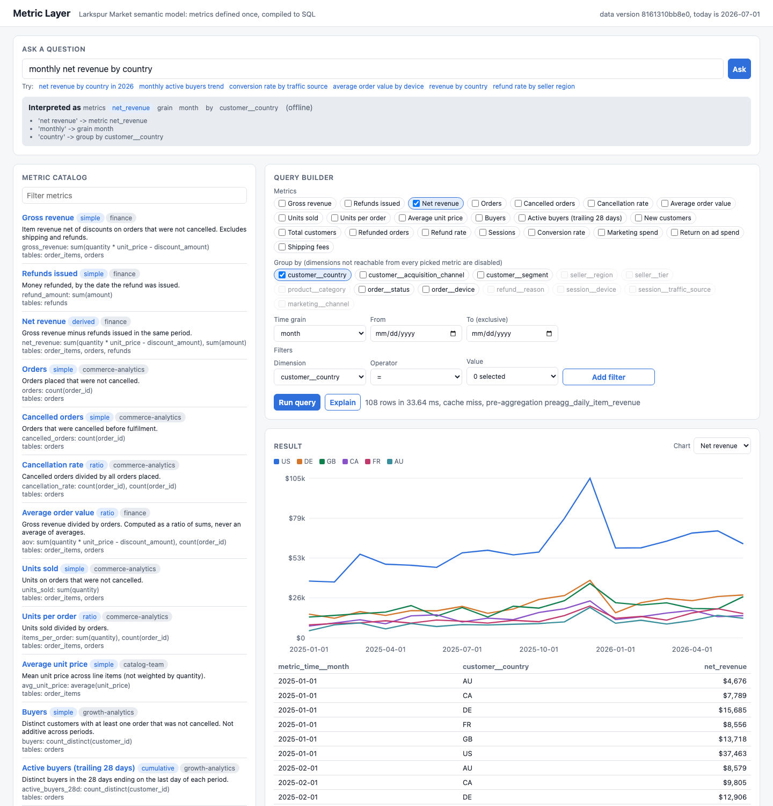
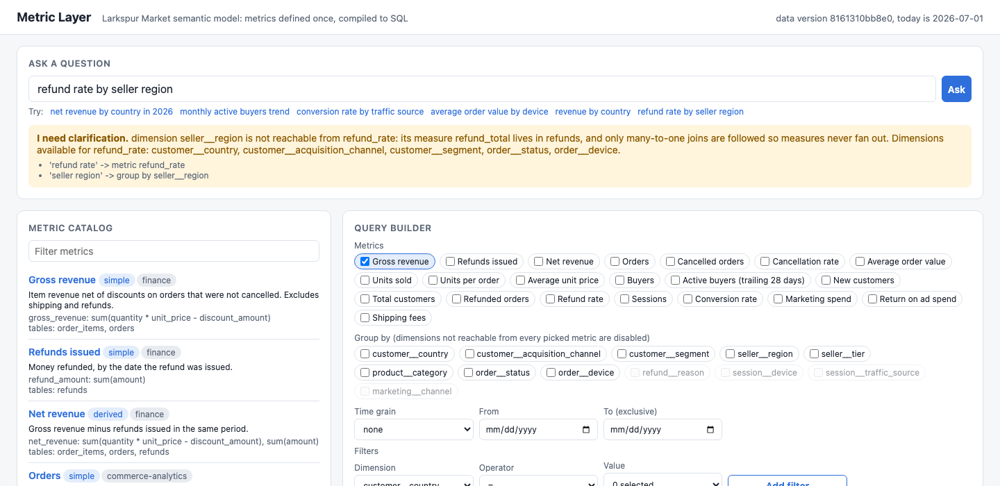

# Metric Layer

A semantic metrics layer for Larkspur Market, a made-up two-sided marketplace. Twenty-one metrics are defined once in YAML (`semantic/marketplace.yml`) on top of an eight-table DuckDB warehouse. A compiler turns a metric query (metrics, dimensions, time grain, filters, time range) into SQL that cannot double count, and a natural language box maps plain-English questions onto those governed metrics instead of writing free-form SQL. It is the pattern behind dbt Semantic Layer, Cube, and LookML, built small enough to read in an afternoon.



## Naive SQL vs compiled metrics

The warehouse has the grain traps real warehouses have: `order_items` is finer than `orders`, refunds are partial and an order can have up to three, and 40% of sessions are anonymous (`customer_id` is NULL). These are the hand-written queries an analyst might reach for, against the compiled metric on the same data (20,000 orders, seed 7):

| Metric | Naive SQL | Compiled | Error | Cause |
|---|---:|---:|---:|---|
| Net revenue, all time | 2,414,666 | 2,486,970 | -2.9% | orders JOIN order_items JOIN refunds: each refund repeats once per line item, each item once per refund |
| Refunds issued, all time | 212,237 | 78,632 | +169.9% | same join, refund side only: a refund on a 4-item order is counted 4 times |
| Average order value | 64.03 | 136.35 | -53.0% | AVG over joined item rows averages line items, not orders |
| Sessions, all time | 67,956 | 100,000 | -32.0% | INNER JOIN to customers to get country drops anonymous sessions |
| Conversion rate | 0.2763 | 0.2000 | +38.2% | average of per-customer conversion rates (an average of ratios) |

The net revenue error looks small only because two errors cancel: gross revenue is overstated and refunds are overstated more. The compiled SQL for `net_revenue` and `aov` by country and month:

```sql
WITH
  agg_order_items AS (            -- item revenue, read from the daily pre-aggregation table
    SELECT CAST(date_trunc('month', metric_time__day) AS DATE) AS metric_time__month,
           customer__country, SUM(item_revenue) AS item_revenue
    FROM preagg_daily_item_revenue
    WHERE order__status IS DISTINCT FROM 'cancelled'
    GROUP BY 1, 2),
  agg_refunds AS (                -- refunds at their own grain, by the date they were issued
    SELECT CAST(date_trunc('month', refunds.refunded_at) AS DATE) AS metric_time__month,
           customers.country AS customer__country, SUM(refunds.amount) AS refund_total
    FROM refunds AS refunds
    LEFT JOIN orders AS orders ON refunds.order_id = orders.order_id            -- many_to_one
    LEFT JOIN customers AS customers ON orders.customer_id = customers.customer_id
    GROUP BY 1, 2),
  agg_orders AS (...),            -- order count for the AOV denominator
  keys AS (SELECT metric_time__month, customer__country FROM agg_order_items UNION ...)
SELECT keys.metric_time__month, keys.customer__country,
  (COALESCE(agg_order_items.item_revenue, 0) - COALESCE(agg_refunds.refund_total, 0)) AS net_revenue,
  CAST(COALESCE(agg_order_items.item_revenue, 0) AS DOUBLE) / NULLIF(agg_orders.order_rows, 0) AS aov
FROM keys
LEFT JOIN agg_order_items ON keys.metric_time__month IS NOT DISTINCT FROM agg_order_items.metric_time__month AND ...
```

Run `uv run metriclayer compile '<query json>'` to print the SQL for any query.

## Correctness proof

`eval/reference_queries.yml` has 20 metric queries, each with SQL written by hand against the raw tables. `metriclayer verify` runs every compiled query twice (with and without the pre-aggregation table) and fails if either result differs from the reference. CI fails the build on any mismatch.

| Coverage | Cases |
|---|---|
| Measures at different grains in one query (items, orders, refunds) | gross and net revenue by country, net revenue by month, units per order by country |
| Ratio of sums | AOV by month, cancellation rate by device, conversion rate by country, refund rate by segment |
| Count distinct (not additive) | buyers by month, refunded orders by reason |
| Cumulative windows | trailing 28-day buyers daily and weekly by country, all-time customers by quarter |
| Multi-hop joins and filters | revenue by seller region (3 hops) for US and Canada buyers excluding books |
| Nullable join keys | conversion rate by country with anonymous sessions kept as a NULL group |
| Derived across unrelated models | return on ad spend by month |
| Pre-aggregation routing | 8 of 20 cases are served from the daily table; all 20 also pass on raw tables |

Result: 20 of 20 match. The full table is in `docs/results.md`.

## Natural language evaluation

`eval/nl_eval.yml` has 67 questions: 53 with a gold metric query and 14 where the right answer is a clarification (ambiguous wording like "revenue", metrics not in the catalog like churn, or a dimension the metric cannot reach like refund rate by seller region). Exact match compares the interpreted query to the gold query, ignoring order. Execution match compares result rows.

| Interpreter | Questions | Exact match | Execution match | Clarification recall | False clarifications |
|---|---:|---:|---:|---:|---:|
| Offline matcher | 67 (53 answerable, 14 need clarification) | 92.5% | 92.5% | 100.0% | 2 |
| Claude (`claude-opus-5-5`) | run with `make eval-claude` | not run here | | | |

The four misses, all kept in the set:
- "How many orders were cancelled last month?" maps to `orders` with `status = cancelled`. The compiler rejects that because `orders` already excludes cancelled orders, and suggests `cancelled_orders`. A clarification, but not the gold answer.
- "weekly conversion rate for paid search traffic" and "average order value for orders on web last month" pick up an extra metric from the word "traffic" or "orders".
- "units sold to business customers" asks which "customers" metric was meant.

The matcher and the gold set were written by the same person, so 92.5% is a regression baseline, not a claim about arbitrary questions.



## Why

When every team writes its own SQL for "revenue", the numbers disagree and nobody can say which one is right. The common causes are mechanical: joining a fine-grained table to a coarse one repeats rows, averaging per-group ratios weights small groups like large ones, and inner joins on nullable keys drop rows silently. A semantic layer fixes the definition once, with an owner, and makes the safe SQL the only SQL. Putting an LLM in front of it is then safe in a way text-to-SQL is not: the model can only pick from governed metrics and dimensions, and everything it picks is validated before it runs.

## How it works

```
 question ──> interpreter (offline matcher | Claude, JSON schema = catalog enums)
                  │  MetricQuery {metrics, group_by, grain, filters, time_range}
 query builder ───┤
                  v
          validate against the semantic model (unknown names, unreachable dimensions,
                  │  contradicting filters, cumulative without time)
                  v
          compile: one CTE per (measure table, metric filter) at the query grain
                  │  only many_to_one LEFT JOINs inside a CTE, then join CTEs on the keys
                  v
          route to pre-aggregation if additive and every dimension is in it
                  v
          result cache: sha256(compiled SQL + data version) ──> DuckDB
```

**Semantic model.** Each semantic model maps to a table and declares entities (join keys), dimensions, and measures (`sum`, `count`, `count_distinct`, `average`). A foreign entity points at the one model where that entity is primary, which makes that join `many_to_one`. Dimensions are named `entity__dimension` (for example `customer__country`), and `metric_time` maps to each measure's own time column, so refunds are dated by `refunded_at` and items by their order's `ordered_at`. Metrics are `simple`, `ratio`, `derived` (an expression over other metrics), or `cumulative` (a trailing window, or all-time). Every metric has an owner, a description, and optional filters. Validation reports every problem at once: unknown measures, foreign keys without a primary, cycles in derived metrics, filters on unreachable dimensions, non-additive measures in a pre-aggregation.

**Fan-out avoidance.** This is the pre-aggregation approach (aggregate each measure at its own grain, then join), rather than symmetric aggregates (LookML's `SUM(DISTINCT key + value) - SUM(DISTINCT key)` trick that de-duplicates after a fan-out join). Inside a CTE the compiler only follows `many_to_one` joins, so a measure's rows are never repeated. A dimension that would need a `one_to_many` join is unreachable and the query is rejected with a reason: "dimension seller__region is not reachable from refund_rate: its measure refund_total lives in refunds, and only many-to-one joins are followed so measures never fan out." The CTEs each have one row per key, so joining them on the keys (null-safe, through a union of keys) cannot fan out either. Pre-aggregating is simpler to read, works on any SQL engine, and handles count distinct, which symmetric aggregates handle only with care.

**Ratios** are `CAST(SUM(numerator) AS DOUBLE) / NULLIF(SUM(denominator), 0)` computed after aggregation, so they are a ratio of sums at every grain. **Derived** metrics combine aggregated metrics with missing values as zero. **Cumulative** metrics join a spine of periods to the raw rows: for a trailing window, rows in the N days ending on the last day of each period; for all-time, every row before the period ends. Rows before the requested time range still count toward the first window.

**Filters** compile to literals with quotes escaped, and `!=` and `not in` keep NULLs (`IS DISTINCT FROM`), so excluding the US does not also drop anonymous sessions.

**Caching.** Results are cached by sha256 of the compiled SQL plus the data version (a hash written to `_meta` when the warehouse is built), so a rebuild can never serve stale results. Equivalent queries compile to the same SQL and share an entry. `preagg_daily_item_revenue` (item revenue and units by day, status, device, category, country, seller region) is built at startup; queries that only need those dimensions read about 33,000 rows instead of joining 42,000 line items to four tables. `/api/cache` shows hit rate, pre-aggregation hits, and the most used metric and grain, which is how you would pick the next table to build.

**Natural language.** The offline matcher normalizes the question, parses the time range ("last 90 days", "Q1 2026", "between January and March 2026", "since March"), then matches metric, dimension, and value phrases longest first, so "business buyers" is a filter and "traffic source" is a dimension. Values that belong to several dimensions ("web" is an order device and a session device) resolve by which one the metric can reach. Ambiguous words ("revenue", "customers", "refunds") return a question. The Claude interpreter sends the catalog and asks for structured output with a JSON schema whose enums are the metric and dimension names, so it cannot invent one, and its answer goes through the same validation. Only metadata and distinct dimension values are sent, never rows.

## Run it

```bash
cd metric-layer
uv sync --python 3.12
uv run metriclayer build            # 20,000 orders, about 6 seconds; the server also builds on first start
uv run metriclayer serve            # http://127.0.0.1:8840
uv run metriclayer verify           # reference SQL suite and the naive join table
uv run metriclayer nl-eval --show-misses
uv run metriclayer compile '{"metrics": ["aov"], "group_by": ["order__device"], "grain": "month"}'
```

Or with make: `make install build run`, `make verify`, `make eval`, `make report` (writes `docs/results.md`).

To use Claude: `uv sync --extra claude`, set `ANTHROPIC_API_KEY`, then `METRICLAYER_NL=claude uv run metriclayer serve` or `make eval-claude`. Without a key everything runs offline.

API:

| Endpoint | What it does |
|---|---|
| `GET /api/metrics` | catalog with type, owner, reachable dimensions, and lineage to tables |
| `POST /api/query` | structured metric query, returns rows, SQL, cache and pre-aggregation info |
| `POST /api/ask` | `{"question": "..."}`, returns the interpretation (or a clarification) and the result |
| `POST /api/explain` | compiled SQL, one entry per CTE with its join path and cardinality |
| `GET /api/cache` | hit rate, pre-aggregation hits, most used metric and grain |
| `GET /healthz`, `GET /metrics` | health and Prometheus metrics; every request logs one JSON line |

Docker is not installed on the machine this was built on, so the `Dockerfile` is built and smoke tested in CI only. The container builds a smaller warehouse at startup when `METRICLAYER_ORDERS` is set.

## Tests

154 tests (`uv run pytest -q`), about 15 seconds:
- YAML validation (15): every kind of model error, reported together.
- Join paths (10): multi-hop paths, one-to-many never followed, reachable dimensions for ratio metrics.
- Compiler (27): validation errors with suggestions, ratio and derived SQL, null-safe filters, quote escaping.
- Fan-out on a hand-built dataset (25): an order with 3 items and 2 refunds, where naive SQL gives 165 and 63 and the compiler gives 115 and 24; ratios by group, anonymous sessions, every time grain, daily, monthly, and all-time cumulative windows.
- Reference suite (23): all 20 reference queries with and without pre-aggregation on a generated warehouse.
- Natural language (29): time parsing, value resolution, negation, clarifications, the eval thresholds, and Claude structured output with a fake client (schema enums, invalid names, refusals, bad JSON).
- Cache (10): keys, hits, LRU eviction, data versions, pre-aggregation routing.
- API end to end (15).

CI runs ruff, the tests, the reference suite and NL eval with tables in the job summary, and a Docker build with a container smoke test.

## Production notes

- At warehouse scale the compiler would emit dialect-specific SQL (Snowflake, BigQuery) through a SQL builder such as sqlglot instead of string templates, and push the result cache into a shared store like Redis keyed the same way.
- Pre-aggregations would be chosen from query logs and refreshed incrementally by partition, with a freshness check before routing, as Cube does with its rollups.
- The data version would come from the warehouse (table snapshot IDs or last-modified times per table), so a change to one table only invalidates queries that read it.
- Metric definitions would live in a repository with review by the owning team, and CI would run the reference suite against a staging warehouse before a definition change merges.
- Row-level security and per-team dimension access would be enforced in the compiler, since every query already passes through it.
- The NL interface would log every interpretation with the user's correction, which grows the eval set from real questions.

## License

MIT. See [LICENSE](LICENSE).
